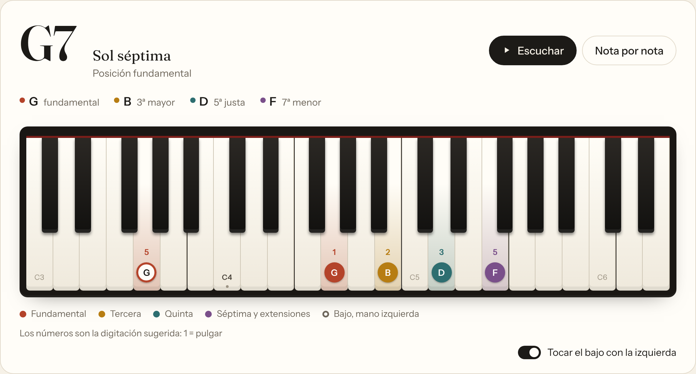

# Acordes

Una página para aprender acordes de piano: eliges un acorde, lo ves en el teclado con la digitación sugerida y lo escuchas en un piano de cola de verdad. Después pegas los acordes de una canción que te guste y la practicas acorde por acorde.

**[Abrir la aplicación →](https://fabianimv.github.io/learn-piano/)**



## Qué puedes hacer

**Explorar acordes**
- 12 fundamentales y 15 tipos de acorde: mayor, menor, disminuido, aumentado, sus2, sus4, 7, maj7, m7, m7♭5, dim7, 6, m6, add9 y 9.
- Cada nota aparece coloreada según su función (fundamental, tercera, quinta, séptima) y con el número de dedo de la mano derecha.
- Inversiones, con una explicación de qué nota queda abajo.
- Los siete acordes de la tonalidad (I, ii, iii, IV, V, vi, vii°), para entender qué acordes van juntos.
- Notación americana (C D E) o latina (Do Re Mi). Las notas se escriben como corresponde: Si♭ en Fa mayor, no La♯.

**Practicar una canción**
- Escribe los acordes (`C G Am F`) o pega una canción completa sacada de un cancionero: las líneas de letra, los títulos como `[Coro]` y las marcas como `x2` se descartan solos.
- Entiende cifrados en inglés y en español: `F#m7`, `Bb`, `C/E`, `Lam`, `Sib7`, `Re/Fa#`, `C7M`, `Bø`…
- Avanza con las flechas o con reproducción automática a tu tempo, con metrónomo opcional.
- **Transportar**: sube o baja la canción por semitonos para cantarla en tu tono.
- **Enlace suave**: elige la inversión de cada acorde más cercana a la anterior, como lo haría un pianista, para que la mano casi no se mueva.
- **Copiar enlace**: la canción queda dentro del enlace para compartirla.

**Con un piano digital**
Si conectas un teclado MIDI por USB (Chrome o Edge), la página muestra qué acorde estás tocando, te avisa cuando aciertas y, en el modo canción, pasa sola al siguiente acorde.

## Atajos de teclado

| Tecla | Acción |
| --- | --- |
| `Espacio` | Escuchar otra vez · en una canción, reproducir o pausar |
| `A`–`G` | Elegir la fundamental · en una canción, saltar al siguiente acorde con esa letra |
| `M` | Cambiar entre mayor y menor |
| `↑` `↓` | Cambiar de inversión |
| `←` `→` | Acorde anterior y siguiente |
| `1`–`7` | Acordes de la tonalidad |

## Desarrollo

Es un sitio estático, sin dependencias ni paso de compilación. Como usa módulos de JavaScript, hay que servirlo por HTTP (abrir `index.html` directamente no funciona):

```sh
npm start        # sirve la página en http://localhost:8000
npm test         # pruebas de teoría musical y del lector de canciones (Node 20 o superior)
```

```
index.html
css/styles.css
src/
  theory.js      notas, tipos de acorde, lectura de cifrados, inversiones, digitación, reconocimiento
  song.js        convierte el texto pegado en líneas de acordes; ejemplos
  audio.js       piano grabado (con síntesis de respaldo), reverb y metrónomo
  keyboard.js    dibuja el teclado y marca las notas
  midi.js        entrada desde un teclado MIDI
  app.js         estado de la página y eventos
assets/piano/    muestras del piano (ver su README)
test/            pruebas con node:test
```

Cada push a `main` corre las pruebas y publica el sitio en GitHub Pages (`.github/workflows/deploy.yml`). Para activarlo: *Settings → Pages → Source: GitHub Actions*.

## Créditos

El sonido es el [Salamander Grand Piano](https://archive.org/details/SalamanderGrandPianoV3) de Alexander Holm, con licencia CC BY 3.0, en la versión MP3 que distribuye [Tone.js](https://github.com/Tonejs/audio).
